# ⌚📱 iOS ↔ Wear OS Direct BLE Bridge (100% Nativo)

Puente nativo de **Bluetooth Low Energy (BLE) directo**, sin servidores en la nube, sin bases de datos externas y sin Atajos manuales de iOS, diseñado específicamente para vincular el **Samsung Galaxy Watch 6 Classic (Wear OS 4/5)** con el **iPhone 16 Pro Max (iOS 17/18)**.

---

## 🚀 Arquitectura 100% Direct-BLE (Zero Cloud)

```mermaid
flowchart LR
    subgraph Watch["⌚ Galaxy Watch 6 Classic (watch-app)"]
        ANCS["Cliente BLE GATT\nANCS + AMS + CTS + BAS"]
        GATT_SRV["Servidor BLE GATT\nBridgeSyncService"]
        HID["BluetoothHidDevice\nObturador Cámara (0xE9)"]
        HFP["Bluetooth HFP\nLlamadas en Muñeca"]
        SENSORS["Sensores Directos + Health Connect\nPasos, BPM, Peso, BIA"]
        TILE["Wear OS Tile Nativo"]
    end

    subgraph iPhone["📱 iPhone 16 Pro Max (ios-app SwiftUI)"]
        CBC["CoreBluetooth Central\nRestauración en Background"]
        HK["HealthKit Auto-Sync\nSalud de Apple"]
        AV["AVFoundation + Torch\nAlarma Buscar mi iPhone"]
        EK["EventKit\nPróximo Evento de Calendario"]
    end

    Watch <==>|"BLE Directo (0 ms nube)"| iPhone
```



### ¿Qué incluye cada aplicación nativa?

1. **[`watch-app/`](./watch-app) (Wear OS - Kotlin + Jetpack Compose + Wear Tiles)**
   - **Notificaciones de iOS en tiempo real (`ANCS`)**: WhatsApp, Instagram, Mensajes, Gmail, X, Telegram, etc., con filtro por aplicación y sincronización de descarte (`DeleteIntent` → `ANCS Negative Action`).
   - **Llamadas entrantes y manos libres (`ANCS` + `HFP`)**: Vibración continua en bucle, alerta a pantalla completa (`FullScreenIntent`), botones para atender o cortar desde el reloj y audio en muñeca.
   - **Control Multimedia (`AMS`)**: Play/Pause, pista anterior/siguiente y control de volumen con soporte de **bisel giratorio físico (`onRotaryScrollEvent`)**.
   - **Obturador de Cámara Real (`BluetoothHidDevice`)**: Emula un control multimedia HID (`Consumer Control Volume Up 0xE9`) que dispara fotos y videos en la app Cámara nativa de iOS.
   - **Salud en tiempo real**: Lectura directa de hardware (`TYPE_STEP_COUNTER` + `TYPE_HEART_RATE`) combinada con **Health Connect** (Peso y % Grasa Corporal BIA de Samsung Health).
   - **Wear OS Tile (Tarjeta Rápida)**: Desliza a la izquierda desde la esfera del reloj para ver estado de conexión, batería del iPhone, pasos, pulso, disparar cámara o hacer sonar el iPhone.

2. **[`ios-app/`](./ios-app) (iOS 17+ - Swift + SwiftUI + CoreBluetooth + HealthKit)**
   - **Reconexión automática en segundo plano**: Usa `bluetooth-central` y `CBCentralManagerOptionRestoreIdentifierKey` para mantener el enlace con el reloj incluso con la app cerrada.
   - **Escritura directa en Apple Health (`HealthKit`)**: Guarda automáticamente pasos, frecuencia cardíaca (BPM), peso (kg) y porcentaje de grasa corporal medidos por tu Galaxy Watch 6 Classic.
   - **Alarma "Buscar mi iPhone"**: Al tocar *"Hacer sonar mi iPhone"* en el reloj, el iPhone activa una sirena acústica por altavoz (incluso en modo Silencio) y parpadea el flash LED trasero.
   - **Contexto del iPhone hacia el reloj**: Envía porcentaje de batería del iPhone, estado de carga y tu próximo evento de calendario (`EventKit`).

---

## 🛠️ Instalación Paso a Paso

### 1. Instalar la App en el Galaxy Watch 6 Classic (`watch-app`)
1. En tu reloj, ve a **Ajustes → Acerca del reloj → Información de software** y toca 7 veces sobre **Número de compilación**.
2. Ve a **Ajustes → Opciones de desarrollador** y activa **Depuración por ADB** y **Depuración inalámbrica**.
3. Conecta por ADB desde tu PC y compila/instala:
   ```powershell
   cd watch-app
   .\gradlew.bat assembleDebug
   adb install -r build\outputs\apk\debug\watch-app-debug.apk
   ```

### 2. Instalar la App Nativa en el iPhone 16 Pro Max (`ios-app`)
- **Desde Windows (sin Mac) usando GitHub Actions + Sideloadly / AltStore**:
  1. Al hacer push a GitHub, el workflow [`.github/workflows/native-build.yml`](./.github/workflows/native-build.yml) compila automáticamente el archivo **`AncsBridgeIOS-unsigned.ipa`** en un runner `macos-14`.
  2. Descarga el artefacto `ios-companion-unsigned-ipa` desde la pestaña **Actions** de tu repositorio.
  3. Abre **Sideloadly** o **AltStore** en Windows, conecta tu iPhone 16 Pro Max, arrastra el `.ipa` e ingresa tu Apple ID gratuito para firmarlo e instalarlo.
- **Desde macOS con Xcode**:
  ```bash
  cd ios-app
  brew install xcodegen
  xcodegen generate
  open AncsBridgeIOS.xcodeproj
  ```
